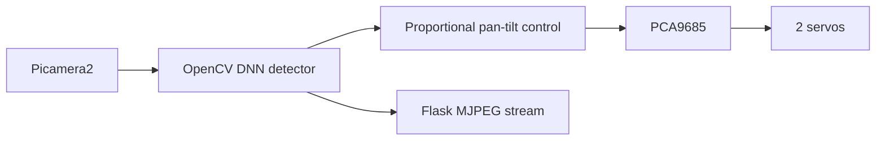

# image-recognition-pi

My Raspberry Pi 5 computer vision lab: the experiments that led to [Auto-Turret](https://github.com/elie-hallermeier/Auto-Turret), kept as they were written.

## The problem

Before building a tracking rig I had to answer a list of small questions on real hardware. Which detector is fast enough on a Pi CPU? How small a face can it still find? How do you move two hobby servos without them shaking? Each script here answers one of them.

## What I built

A set of standalone scripts, each runnable on its own, that grow from "show the camera" to a pan-tilt tracker with a web stream.

| Script | What it does |
|---|---|
| `cam-prev.py` | Camera preview at a chosen resolution and frame rate |
| `servo_test.py` | Sweeps two servos through a PCA9685 |
| `multi-object-detection.py` | MobileNet-SSD on the 20 PASCAL VOC classes |
| `upper-body.py` | Person detection only, streamed over Flask |
| `upper-body-tracking.py` | Person detection driving the pan-tilt servos |
| `face_tracker.py` | Face tracking with SSD-ResNet10, down to faces of about 20x20 px |
| `autot-2person.py` | Tracks two faces at once, with a 2 second hold per target to stop flicker |
| `auto-turret-v1.py`, `auto-t-body+face.py` | Tracker plus a countdown and a relay output on GPIO 6 |
| `trigger-push.py` | Relay timing test |
| `drowziness-tracker.py` | Side experiment: MediaPipe Face Mesh, eye aspect ratio per eye, buzzer when both eyes stay closed |

The cleaned-up result, face first with body fallback and no relay code, is the Auto-Turret repo.

## Architecture

Every tracking script has the same shape:



Models in the repo: SSD-ResNet10 for faces, MobileNet-SSD for people, OpenCV Haar cascades, and an OpenVINO face-detection model in `models/intel/`.

## What carried over to Auto-Turret

- Face first, body as fallback (`auto-t-body+face.py`). A face gives a tight aiming point, and the person detector takes over when the face is lost.
- A deadband around the image center, so the servos stop moving once the target is within a few pixels.
- Holding the last target for a moment after it disappears, which removes the flicker between tracking and scanning.
- A scan pattern when nothing is in view.

## Setup

On a Raspberry Pi 5 with a camera and a PCA9685 on I2C:

```bash
sudo apt install -y python3-picamera2 python3-opencv
```

```bash
python3 -m venv --system-site-packages .venv && .venv/bin/pip install -r requirements.txt
```

Run any script from the repo root, since the model files are loaded from the current directory:

```bash
.venv/bin/python face_tracker.py
```

The streaming scripts serve on `http://<pi-ip>:5000/`.

Clone with `--depth 1`. Two virtualenvs were committed by mistake early on. They are removed from the tree now, but they are still in the history and make a full clone about 230 MB.
